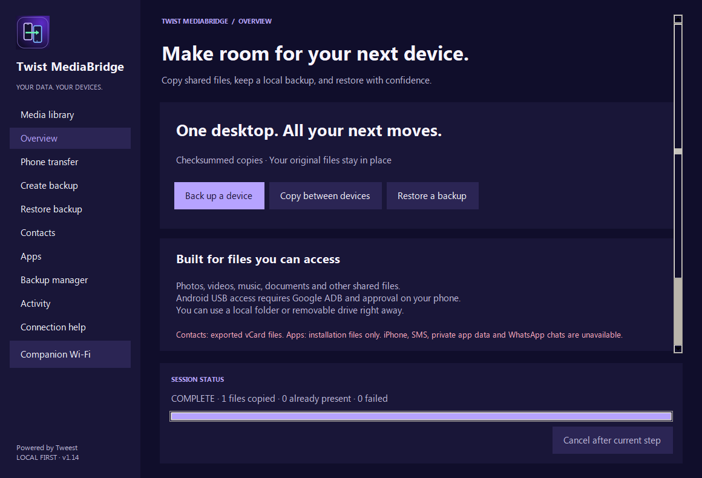

# Twist MediaBridge

**Windows download:** [Latest release](https://github.com/twistkan/twist-mediabridge/releases/latest). This repository contains source code; packaged executables are in Releases.


A local Windows desktop app for Android media transfers, contacts, app installation backups and verified file backups.

**Current build:** 1.15  
**Executable:** `Ready-to-use-1.15/TwistMediaBridge.exe`  
**Complete recreation prompt:** [BUILD-PROMPT.md](BUILD-PROMPT.md)

The sidebar and phone companion include **Powered by Tweest**. New: [Companion Wi-Fi for Android 6+, including Android 9](COMPANION-WIFI.md), alongside existing USB and Android wireless debugging.

## Screenshot



Overview shown in version 1.14.

## Start the app

1. Open `Ready-to-use-1.15/TwistMediaBridge.exe`.
2. The app keeps an installed copy under `%LOCALAPPDATA%/TwistMediaBridge/Application/` and creates a **Twist MediaBridge** desktop shortcut.
3. Use the shortcut for later launches. If deleted, launching the executable again recreates it.

The root `TwistMediaBridge.exe` is also the current 1.15 delivery. Historical `DeviceBridge` executables contain earlier designs.

No Python, Java, Android Studio or separate Platform Tools installation is needed to run the packaged app. Android tools, preview components and the Contacts Bridge APK are embedded. Runtime components extract temporarily; settings and backups are stored separately.

## Connect a phone

1. Enable Developer options and USB debugging on the phone.
2. Connect a USB data cable, unlock the phone and approve the computer's debugging request.
3. Click **Find phones** or **Refresh phones**, then select the device.

Galaxy S/A/Z families and other Android brands use the same connection code. There is no S21 Ultra model lock; S22 Ultra, S23 Ultra and other models are not excluded by name. Individual model compatibility still requires physical testing.

If detection fails, check authorization and try another cable/port. Windows may need the manufacturer's USB driver; see the [official Samsung driver page](https://developer.samsung.com/android-usb-driver). This is separate from the already embedded Android tools.

**Connection help → Use built-in tools** resets automatic selection. **Custom adb.exe…** is optional advanced setup.

## Connect over Wi-Fi — Android 11 or newer

Wi-Fi works over a local network even if the router has no internet connection. The phone and PC must be on the same network and allowed to communicate. The PC can be wired to that same router. A mobile-data connection is not required. Guest-network isolation, VPNs, Windows/router firewalls or managed networks may block the local connection; use a trusted private network and permit the local connection as needed. The app does not change firewall rules automatically.

1. On the phone, open **Settings → Developer options → Wireless debugging**, turn it on and allow your trusted network. Menu names can differ.
2. In MediaBridge, click **Wi-Fi…** in Media library, or **Connection help → Connect over Wi-Fi…**.
3. Click **Find nearby phones** and select your phone. Only phones advertising Wireless debugging can appear. Unpaired phones may show an Android device identifier instead of a friendly model name.
4. On that phone, tap **Pair device with pairing code** and keep the popup open. You can also open this before finding phones.
5. Enter only the six-digit code in MediaBridge and click **Pair & connect**. Addresses and the connection port are resolved automatically.
6. After a verified connection, the phone becomes the selected Media library source. Click **Load albums** and transfer normally. Existing Contacts/Apps workflows use the same authorized Android connection, with their usual permissions and limitations.

**Connect selected** now shows an immediate activity indicator and a status beside the buttons. If Android reports that this computer is not authorized, the app opens a masked six-digit PIN prompt. A discovered TLS port that is reachable but cannot complete its ADB handshake also offers pairing guidance; an unreachable phone shows a network error instead. Open the pairing-code screen on the phone first, then enter that code. If you already entered a code in the main form, Connect selected uses the pairing flow. Failed network connections show a visible error dialog; selecting the same row again does not erase the error or an entered PIN.

Use **Phone setup help** for on-phone instructions. On OPPO/ColorOS, Developer options is typically under Additional settings or System settings. Tap the Wireless debugging name to open its screen, not just the toggle. If Developer options is hidden, OPPO documents enabling it via About phone → Version → tap Version number seven times. Exact menus and availability depend on phone software. See [OPPO's guide](https://support.oppo.com/en/answer/?aid=neu7554). The PC cannot remotely open an unpaired phone's pairing screen, and a discoverable phone is not necessarily authorized.

Already paired? Find/select the phone and click **Connect selected**; no new code is normally needed. A changed network or phone restart may require finding it again. Discovery uses Android's local mDNS advertisements, not an internet service or an unrestricted scan of other devices.

If no phone appears, enable Wireless debugging and open its pairing-code popup, then find again. Guest/client isolation, VPNs or firewall rules may block discovery. **Advanced manual connection** reveals the previous pairing IP:port/code and separate connection IP:port fields as a fallback. The pairing and connection ports are usually different. If multiple ambiguous services share a host, the app does not guess a target.

Use **Disconnect** in the Wi-Fi assistant to close a specific active connection. To revoke trust, **Forget** this computer under the phone's Wireless debugging paired devices. Pairing codes are masked and not saved by MediaBridge; Android/ADB retain approved computer pairing until revoked.

### QR pairing

Click **Pair with QR code**. On the phone open **Wireless debugging → Pair device with QR code**, then scan the code shown on the PC using that scanner. A normal camera app may not start Android debugging pairing. Keep the PC window open while it waits for the phone's matching pairing advertisement and verifies the connection.

Each QR session uses a new random service identifier and password, stays only in memory and expires after five minutes. Cancel closes the code and stops waiting; generate a new QR code to retry. QR codes/passwords are not saved to settings or diagnostic logs. Scanning or closing the phone scanner is not itself evidence that pairing succeeded: wait for the PC's verified connection result.

QR pairing avoids PIN/address typing but does not bypass network isolation, firewalls or missing phone-side Wireless debugging support. It still needs local service discovery. Supported phone software may expose a dedicated QR scanner; its availability has to be checked on the actual device.

### Discovery troubleshooting

**Find nearby phones** now queries Android advertisements through two methods: ADB's existing list and an independent multicast scan across active IPv4 interfaces. Fresh direct results replace stale ports reported by ADB. Empty ADB lists no longer prevent a directly discovered phone from being listed. Previously authorized Wi-Fi devices are also checked.

If the list is empty, toggle Wireless debugging off and on, keep the phone's pairing screen open, verify the same local network and retry. Being connected to Wi-Fi alone does not advertise an Android debugging service. Guest/client isolation and firewall rules can block multicast or the connection itself. The app does not silently restart the shared ADB server, change Windows network trust or disable firewalls. Advanced manual connection remains available when discovery is blocked. Current direct scanning uses IPv4; manual IPv6 addresses remain supported by ADB connection entry.

Keep Wireless debugging enabled and the phone connected to the network during transfers. Wi-Fi speed depends on signal, router and file size; copying is not instantaneous. Losing the network triggers the same phone-content clearing and cancellation checks used for USB disconnects.

**Android 9/10:** this cable-free pairing method is unavailable. Older ADB Wi-Fi setup normally requires an initial working USB connection. Use Companion Wi-Fi for Android 9 without USB debugging; see COMPANION-WIFI.md. Bluetooth transport is not included.

Wi-Fi command handling and UI flows were tested with simulations, and the packaged ADB's pairing capability was checked. A physical Android 11+ phone pairing/transfer test remains pending. See the [official Android wireless-debugging guide](https://developer.android.com/tools/adb#connect-to-a-device-over-wi-fi).

## Media library

Select the phone and **Load albums**, or choose a **Local folder**. Browse/search albums and filter photos/videos in a continuously scrolling square-thumbnail grid. Click media to preview; tick individual items or select an album, choose a destination and transfer.

Different existing destination files are preserved and reported as conflicts. **Delete selected** permanently removes selected shared-storage phone media after confirmation.

Accessible locations include DCIM, Pictures, Movies and shared app media. Cloud-only media, Samsung Gallery-only groups and Secure Folder are unavailable. Inaccessible folders may result in a partial scan. In-app video previews may be muted; open separately in a Windows player for full playback.

## Contacts

### Load

Open **Contacts**, select the phone and click **Enable contacts**. On the phone, open Twist Contacts Bridge, tap **Allow contacts access** and approve permission. Back on the PC, click **Load contacts**.

The scrolling table supports search, individual selection, **Select all** and **Clear**. The companion requests network permission for optional local Wi-Fi. Its existing provider is restricted to the Android debugging shell and its own process. Exported phone `.vcf` files remain a fallback.

### Back up

Select contacts, choose **Contact backup format**, then **Back up selected**:

| Format | Output |
| --- | --- |
| One .vcf file (all selected) | Combined file with editable default name `Contacts_YYYY-MM-DD_HH-MM-SS.vcf`. |
| Individual .vcf files | Dated folder with one complete contact-named vCard per person; duplicate names receive safe suffixes. |

Exports preserve native fields supplied by Android and report progress in batches. Incomplete exports are not published as completed backups. Open individual vCards with a compatible Windows contacts application.

### Restore or delete

**Send vCard to phone** stages the file under `Download/TwistMediaBridge`. Finish Import in the phone's Contacts app; staging alone does not import contacts.

**Delete selected** acts on selected live phone contacts after confirmation. Deletion may sync to linked accounts. Exported vCard rows cannot authorize live contact deletion.

### Duplicate finder

Click **Duplicates** to review candidates with matching normalized names or full numbers. All start as **Keep**. Mark proposed removals while retaining a keeper in each group, then apply the marked selection to Contacts.

Nothing is automatically merged or deleted. Removal still requires **Delete selected** and confirmation. Shared names/numbers are candidates, not proof; local/international formats are not guessed to be equivalent.

## Apps

Open **Apps**, select the phone and **Load apps**. The searchable scrolling table shows real names where available, with package IDs as a fallback. Select individual apps or **Select all**, then **Back up selected**.

| Output | Restore |
| --- | --- |
| `App name.apk` | Single-APK app; use **Reinstall file**. |
| `App name.apks` | Verified archive of required base/split APKs; use Twist MediaBridge's **Reinstall file**. |
| Older numbered APK folder | Use **Old folder…**. |

Do not rename `.apks` to `.apk` or discard split components. Android checks signatures, versions and device compatibility. Backups exclude private app data, logins and game progress.

**Delete selected** uninstalls selected apps after confirmation and may remove their local data.

## File transfer, backup and restore

**Phone transfer** copies supported files between explicit sources/destinations. **Create backup** writes files with a manifest and SHA-256 checksums. **Restore backup** verifies selected backup content before writing.

Identical existing files are skipped; different ones are preserved and reported. Keep each complete backup folder, including its manifest and files. **Activity** provides recent summaries and available detailed reports.

Local folders/removable drives are supported. An MTP phone entry under Windows This PC is not a normal folder path; use the Android connection for direct phone access.

## Backup manager

New successful backups appear automatically. Add older ones with **Add backup file**, **Scan backup folder** or **Refresh library**.

- Search/filter backup names and types.
- **Open folder** opens the saved location.
- **Verify** checks recorded hashes. Imported backups establish their baseline when first added.
- **Restore selected** verifies and routes files, APKs or vCards appropriately.
- **Remove from list** removes only the catalog entry, never saved files.

Missing-drive entries remain listed. Hash verification detects changes against recorded baselines; it is not encryption or proof of authenticity.

## Privacy and storage

The app operates locally without an account. Phone pages clear rows, selections and in-app previews after disconnect detection, usually within 1–3 seconds. Late results are ignored and temporary media caches are cleared. External Windows players control their own open content.

Settings, logs and catalog: `%LOCALAPPDATA%/TwistMediaBridge/`. Backups remain at chosen save locations; the default library is under the app's data directory. Backups are not automatically encrypted. Protect them and retain them when moving PCs or cleaning application data.

## Compatibility and validation

- Windows 10 x64 tested locally. Windows 11 testing is deferred until a PC is available.
- Multiple Android phones tested during development; not every Galaxy model/manufacturer physically verified.
- Contacts companion requires Android 6.0+ and permission approval. Device policies may restrict debugging, installation or access.
- Version 1.14.3 passed 116 regression tests plus packaged embedded-ADB, preview, backup/restore and shortcut checks. Wi-Fi discovery/PIN pairing/automatic connection/disconnect UI and failures passed simulated checks; the user has reported a successful wireless connection on an OPPO A9 2020 running Android 11; the exact successful pairing method was not specified, and transfers on other models remain unverified. QR generation, lifecycle, protocol matching and direct-discovery fixtures passed; a packaged loopback smoke check exercises the bundled discovery runtime.
- Physical contact import and app reinstall need checking on the intended destination phone. APKs are not guaranteed to migrate across devices.
- iPhone, private app-data backup, SMS backup and dedicated WhatsApp migration are outside current scope.

## Develop and build

Entry point: `main.py`; desktop modules: `bridge/`; Android companion: `companion/`; tests: `tests/`; UI checks: `tools/`.

Development environment:

```powershell
python -m pip install -r requirements-media.txt
python -m pip install pyinstaller
python main.py
```

The build script expects this project's vendor/dependency layout, official Android tools, companion APK, icon and license files. Rebuild the companion using `companion/build.ps1` only when changing it; this requires configured Java/Android build tools and the preserved signing key.

```powershell
python -m unittest discover -s tests -q
python tools/ui_check.py
./build-media.ps1 -Python 'C:/Program Files/Python314/python.exe'
```

Build output: `release/TwistMediaBridge.exe`. Copy it into a clean versioned delivery folder. Run the packaged diagnostic with an absolute report path whose parent exists:

```powershell
./release/TwistMediaBridge.exe --self-test "D:\Temp\mediabridge-self-test.json"
```

Diagnostics use disposable fixtures rather than deleting real phone content.

See [THIRD_PARTY.md](THIRD_PARTY.md) and embedded notices for dependency attribution. Review applicable distribution obligations, including bundled FFmpeg components, before redistributing modified releases.

### Wireless compatibility clarification

The user confirmed that wireless connection worked on an OPPO A9 2020 running Android 11. The report does not specify whether PIN or QR was the successful method. Samsung models and other brands use the same model-independent ADB adapter; there is no Samsung/S21-only whitelist. Android 11 or newer is the platform prerequisite for cable-free pairing, but the phone must expose and permit Wireless debugging, the user must approve pairing, and the local network must allow communication. Specific Galaxy models and Windows 11 still require testing.

Android 9/10 can also use legacy ADB over Wi-Fi after an initial authorized USB connection enables TCP/IP debugging. This is a separate setup workflow, may need repeating after a reboot and should be used on a trusted local network. The app's advanced manual connection can connect to an already configured endpoint, but this release does not provide a button to enable legacy TCP/IP debugging over USB. Native ADB PIN/QR pairing cannot be added to Android 9 by changing this Windows application alone. The separate Twist Companion now supplies a different cable-free local Wi-Fi protocol. See the [official legacy Wi-Fi setup](https://developer.android.com/tools/adb#connect-to-a-device-over-wi-fi).

### Six-digit pairing: phone screen first

For code pairing, Android does not send an automatic notification when the PC connects. Open **Wireless debugging → Pair device with pairing code** on the phone to generate the code. In version 1.14.3, **Pair using code** with an empty field, or an unpaired Connect action, first waits for that selected phone's code-pairing advertisement. Only then does the PC ask for the six digits. Keep the phone code popup open until completion. Phone setup help stays usable during the wait; cancellation and timeout explain that no notification was sent.

QR and six-digit code pairing are separate workflows. A working existing/QR connection does not prove code pairing worked. The user has confirmed a wireless connection on the OPPO, but reports that its code does not appear; physical PIN pairing remains unverified. Our temporary test was corrected to require a successful real PIN pair command before reporting a PIN-test success.


## Preview timeline and album browsing — v1.14.4

Video previews now have a playhead and elapsed/total time. Click or drag the timeline to seek; a paused seek decodes a frame without starting playback. Space or the Play / pause button toggles playback from the current position. Seeking while playing continues from the chosen position. Embedded playback remains muted; Open in Windows app provides sound/full resolution.

The album list now has internal padding and extra row spacing. Deleting media keeps the current album and sidebar scroll position while items remain. An empty album advances to the next surviving album, or the previous one at the end. Transfers keep the selected album and current scroll position. All media is used when no albums remain. Existing deletion confirmation, transport checks and failed selections remain in place.

Generated-fixture checks cover fast seek to a distinct decoded frame, actual Space/click pause and resume, timeline click/drag, a real local selected transfer, mocked phone-delete completion, album fallback, and original-video hash preservation. No real phone deletion or transfer was performed for this update.


## Larger preview and backup folder actions — v1.14.5

Preview opens in a larger, resizable window constrained to the screen. Photos are decoded up to a 2560-pixel bounding box, preserving aspect ratio instead of baking them into a fixed 680×390 panel. They refit as the window resizes; Fit photo restores the fit view. The system-player button remains available. Originals are read-only. Video playback, seeking and Space controls remain available in the larger canvas.

Contacts and Apps now offer Open backup folder after a successful backup, plus a completion prompt offering to open it immediately. Individual contacts open their actual dated output folder; combined vCards and app backups open their containing folder. Failed/cancelled operations do not claim a new saved location. An unavailable backup drive gives an explanation. No folder opens without your click or confirmation.

Generated-fixture UI validation covered larger landscape/portrait fitting, resize, source hashes, dated individual-contact folders, combined vCard containing folders, Apps backup folders, prompt/button dispatch, unavailable destinations and cancelled/failed jobs. Existing timeline/Space/album tests passed after the canvas change. Explorer dispatch and APK transport were mocked; no real phone was read or changed.


## Previous/Next preview navigation — v1.14.6

Previous and Next buttons sit beside the preview image. Left/Right keyboard arrows navigate photos and videos, including when an action button or timeline has focus. Browsing follows a snapshot of the current album/search/type filters, with an item counter and disabled buttons at the ends. The same preview window and its chosen size are retained. Switching items stops the previous video, cancels its load, resets playback, and updates filename, folder, transfer checkbox and external-open target together. Late image/duration results for older items are ignored. The timeline still supports mouse scrubbing and Home/End/Page keys; Space controls playback.

Generated-fixture tests cover actual key events, buttons, album/search/type scope, boundaries, rapid switching, stale decode/duration messages, mixed photo/video playback cancellation, window-size retention, current-file actions and unchanged original hashes. The prior timeline, larger-preview and Contacts/Apps backup-folder UI checks also passed after this change. No real phone or personal library was used.


## Copy image from preview — v1.14.7

Click Copy image or press Ctrl+C after a photo finishes loading, then paste with Ctrl+V into an image-capable app such as WhatsApp. The action copies full-size, orientation-correct photo pixels from the locally available original; it does not copy a filename, upload anything or alter the photo. Windows DIB and PNG clipboard formats are provided; PNG preserves transparency, while DIB uses a white background for transparent areas. Receiving-app paste support varies.

Image preparation runs in the background. Copy is disabled during loading/copying and for videos. Moving to another item or closing the preview before copying finishes cancels that pending clipboard publication. A successful copy remains on the clipboard after the preview closes. Failures show a visible explanation.

The generated-fixture clipboard check verified real Windows DIB/PNG payloads, full-size pixels, Copy and Ctrl+C, navigation to the current image, EXIF orientation, transparency, clipboard contention and decode errors, cancellation after navigation, disabled video copying and preservation of original hashes. WhatsApp itself was not exercised and no message was sent. Packaged self-test validates image encoding without changing the clipboard.


## Shift-range and Ctrl selection — v1.14.8

Tick a media checkbox, then Shift+click another checkbox to add every file between them in the current album/search/type order. The anchor remains the first file for further Shift clicks. Ranges include off-screen tiles. Previously chosen files are retained; filtered-out files are not newly selected. Changing the album/filter, clearing the selection or changing source resets the range anchor.

Ctrl+click a checkbox to add/remove one file without clearing the others. Ordinary checkbox clicks keep the same additive toggle behavior. Ctrl+click and Shift+click also work on thumbnails and filenames; ordinary thumbnail clicks still open preview. Visible checkbox state/count updates immediately without resetting the grid scroll. Existing whole-album selection still includes the entire album regardless of search/type filters.

Generated-fixture UI checks cover real checkbox press/release events without double toggling, Ctrl add/remove, forward/reverse/no-anchor ranges, thumbnail modifier clicks without opening preview, ranges across virtualized rows, scroll preservation, album/search/type scope, busy input guards, keyboard checkbox activation and exact selected-file transfer with original hashes unchanged. No personal media or phone was used.


## Direct media exports — v1.14.9

Media library exports to a PC folder now save selected files directly into that folder using their original Windows-compatible filenames, without recreating phone or album folders. Phone transfer exports from Android to PC also use this layout. Same-name files with identical contents are verified and skipped; different contents are reported as conflicts, preserving the existing file. Phone files are not renamed. Backup creation, restore and phone-to-phone transfer retain their existing folder structure. This desktop-only update does not require reinstalling Twist Companion. Verified with 120 regression tests and a real desktop gallery export using generated media.


## Bulk companion transfers — v1.14.10 / phone companion 1.4

Update both the Windows executable and existing phone APK. Companion 1.4 counts every successful authenticated request as connection activity, so a separate heartbeat timeout does not end an actively transferring session. Poll/result transport failures can recover while other authenticated traffic remains recent. Certificate failures, explicit disconnect and the desktop 15-second privacy timeout are unchanged. File reads use an Android-owned auto-closing stream. Desktop exports discard only their own incoming temporary file after each item, keeping batch staging bounded; phone and PC-source originals are never removed. Disconnect messages now identify a lost traffic deadline or a closed session. Validated with 123 regression tests, a 24-item batch with a preserved conflict, multi-chunk video transfer, Android connection-health/retry checks and the real Tk companion workflow. Physical Samsung batch testing is still needed after installing the update.


## Thumbnail recovery and export accounting — v1.15

Queued thumbnails now pause while an export owns the connection and resume afterward; they are no longer discarded and left on Loading. Exports include selected totals and a per-file result with source path, destination filename, status and checksum (or failure reason). Activity > Save last detailed report exports those results. Same-content files already present are counted separately from newly copied files. Partial gallery exports display a bounded failure summary. Thumbnail completion is not a prerequisite for exporting a selected file. A native-combobox focus guard also avoids popup callback errors. Validated with 124 regression tests and real Tk checks demonstrating 12 selected files exported before their thumbnails resume. Existing Companion 1.4 is compatible; no phone APK update is needed.


## Version 1.15 — Companion Wi-Fi app installation

Use `Ready-to-use-1.15/TwistMediaBridge.exe` and update the phone in place using `Phone-app-1.5/TwistCompanion.apk`. Apps → Reinstall file now sends an APK or verified Twist .apks set over Companion Wi-Fi and opens a phone-side approval screen. Allow installation from Twist Companion if Android asks, then approve the installer. Android confirms success or reports refusal back to the PC. There is no silent installation. USB / Android wireless debugging, media, contacts and backup workflows remain available. See COMPANION-WIFI.md for steps and limits.

